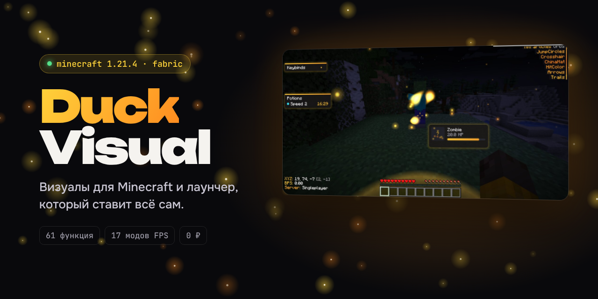
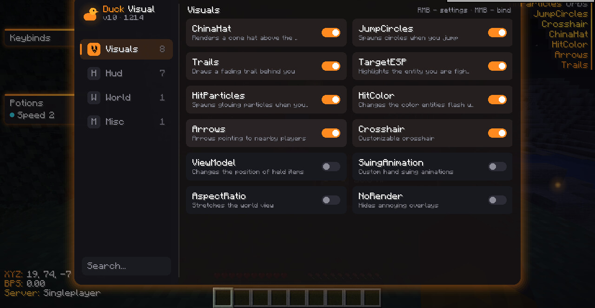
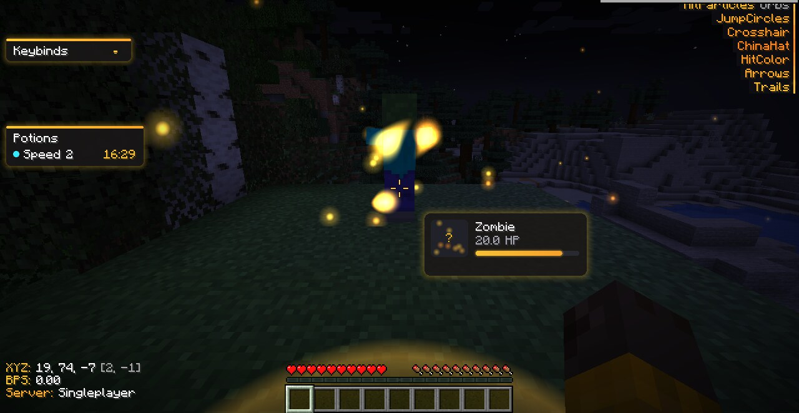
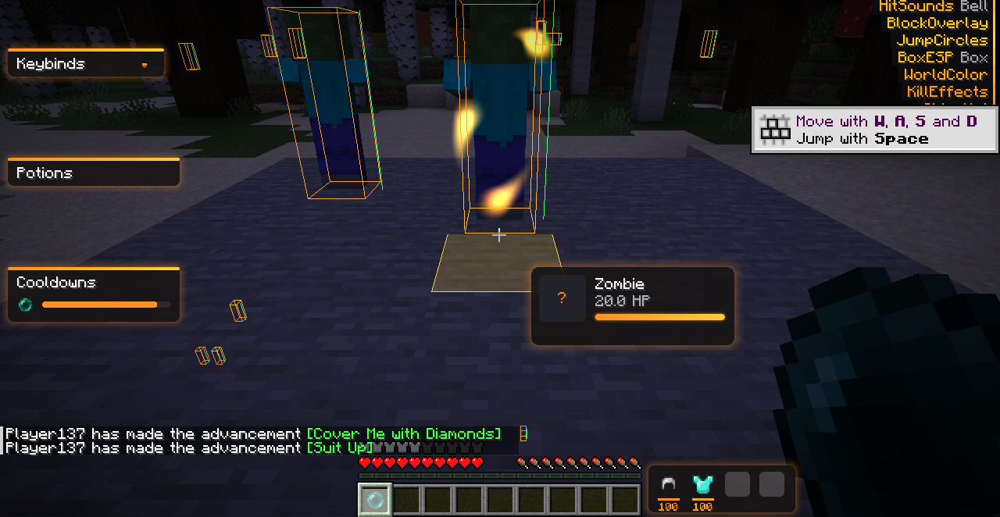
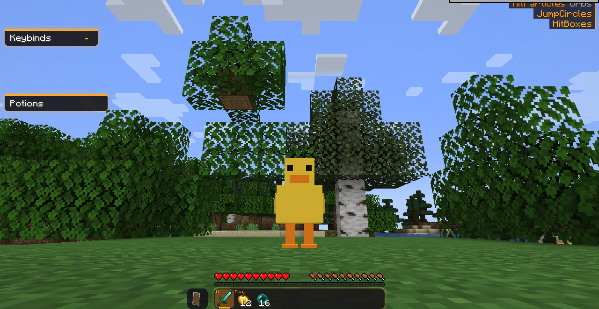
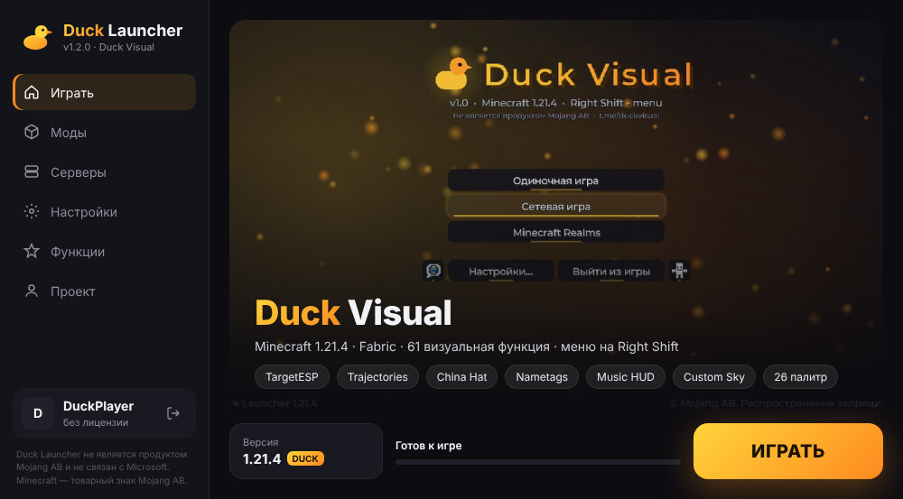
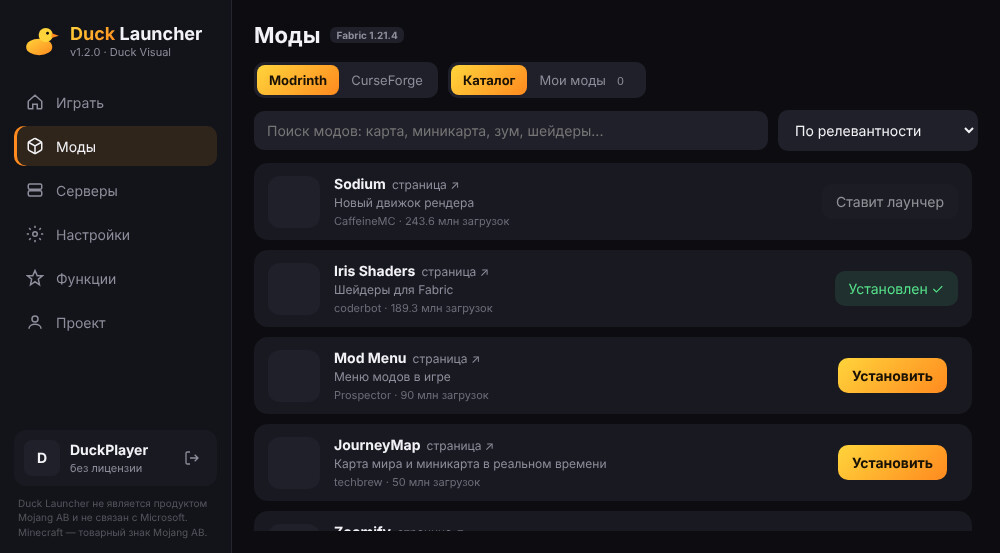
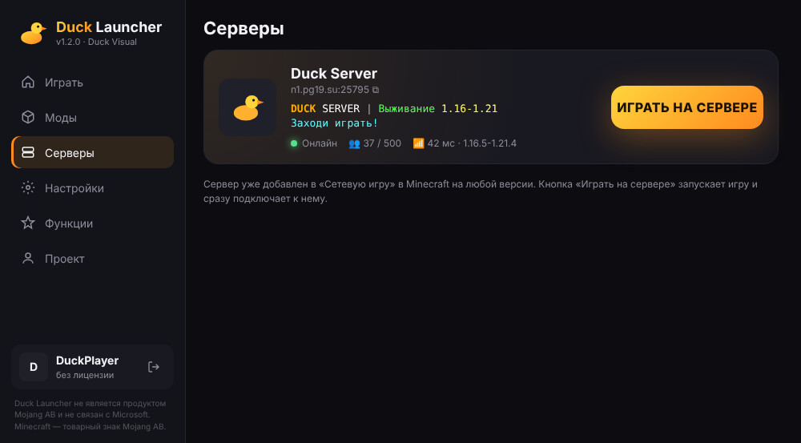

# 🦆 Duck Visual

**Visual mod for Minecraft 1.21.4 and a launcher that sets everything up for you.**
**Free.**

[Русский](README.md) · **English**

---

## ⚡ Getting started

1. Download **[DuckLauncher.exe](https://github.com/AngelPwn927/DuckVisual/releases/latest/download/DuckLauncher.exe)** (Windows 10/11).
2. Run it. If Windows says it "protected your PC", click **More info → Run anyway**: the file is not code-signed yet.
   A short setup asks for the install folder and shortcuts (desktop, Start menu); you can also run it without installing.
3. Enter a nickname and press **PLAY**. The launcher downloads Java, Minecraft, Fabric, Duck Visual and performance mods.
4. In game, press **Right Shift** to open the Duck Visual menu.

> Have your own launcher? Get [`duck-visual.jar`](https://github.com/AngelPwn927/DuckVisual/releases/latest/download/duck-visual.jar) and put it into `mods` together with [Fabric API](https://modrinth.com/mod/fabric-api) (Fabric 1.21.4).

The interface is in Russian; module names are in English.

## ✨ Duck Visual

<table>
<tr>
<td width="50%"> <b>Custom ClickGUI</b> on Right Shift: search, keybinds, per-module settings, 26 palettes</td>
<td width="50%"> <b>TargetESP + TargetHud</b>: target highlight, HP bar, hit particles</td>
</tr>
<tr>
<td> <b>BoxESP, HitBoxes, Cooldowns</b></td>
<td> <b>CustomModels</b>: duck, amogus, rabbit or penguin instead of the player model</td>
</tr>
</table>

**61 modules**, all configurable and bindable:

| Combat | Players & world | HUD | Style |
|---|---|---|---|
| TargetESP · Trajectories · CritIndicator · DamageIndicators · Hitmarker · HitParticles · KillEffects · TargetCircle | Nametags · HealthTags · GlowESP · BoxESP · Tracers · ChinaHat · JumpCircles · CustomSky · WorldParticles | Watermark · ArrayList · TargetHud · **Music** · Cooldowns · Potions · Keybinds · ArmorHud · TabList | 26 palettes · Montserrat font · Duck-styled Minecraft UI · Freelook · Zoom · MotionBlur |

🎵 **Music HUD** shows what is playing in your browser (YouTube, SoundCloud and more), Spotify and other players.

## 🚀 Duck Launcher

<table>
<tr>
<td width="33%"></td>
<td width="33%"></td>
<td width="33%"></td>
</tr>
</table>

- **Installs everything:** the right Java, Minecraft, Fabric, Duck Visual.
- **Any version** from 1.8.9 to the latest, Fabric or Vanilla, each in its own folder.
- **17 performance mods:** Sodium, Lithium, ModernFix, FerriteCore, EntityCulling and more; each can be turned off.
- **"Max FPS" graphics profile**, discrete GPU on laptops, the modded game starts in about 20 seconds.
- **Mods catalog** for Modrinth and CurseForge with automatic dependencies.
- **Offline accounts** or **Ely.by** (skins).
- **Duck Server** `n1.pg19.su:25795` is already in the server list.

## 🛠 Building

| Folder | What it is | Build |
|---|---|---|
| [`DuckVisual`](DuckVisual) | the mod (Java 21, Fabric) | `./gradlew build` |
| [`DuckLauncher`](DuckLauncher) | the launcher (Go 1.24, WebView2) | `./build.sh` |

## 💛 Support

Duck Visual is free and will stay free.
- Star ⭐ this repository so more people can find it.
- Support with Telegram Stars: [t.me/duckvisual/2](https://t.me/duckvisual/2).
- Share it with friends and send ideas and bug reports to the [channel](https://t.me/duckvisual).

---

Duck Visual and Duck Launcher are not products of Mojang AB and are not affiliated with Mojang AB or Microsoft. Minecraft is a trademark of Mojang AB. Game files are downloaded from Mojang's official servers.
